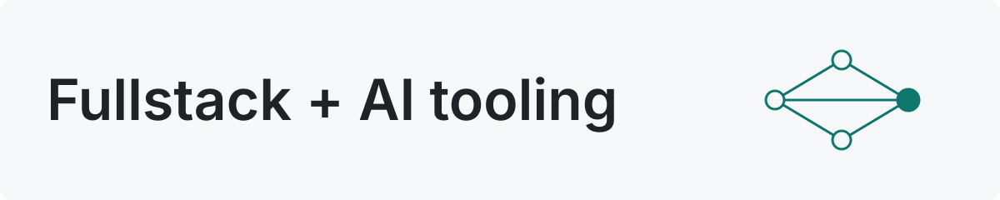

<picture>
  <source media="(prefers-color-scheme: dark)" srcset="./assets/header-dark.svg">
  <source media="(prefers-color-scheme: light)" srcset="./assets/header-light.svg">
  
</picture>

# Hi, I'm Arthur Borges Pereira 👋

Fullstack developer at **Amigo Tech**, based in Recife, Brazil. I build web products with Laravel and React, and developer tools that bring AI agents into everyday workflows.

- 🛠️ **Day to day:** Laravel / PHP, NestJS, React / Next.js, TypeScript, Docker
- 🤖 **Into:** AI-assisted development, multi-agent workflows, developer tooling
- 🦀 **Learning:** Rust (via Tauri) for desktop dev tools
- 🎹 **Off the clock:** I play piano

🇧🇷 Sobre mim em português

Sou dev fullstack na **Amigo Tech**, em Recife. Construo produtos web com Laravel e React, e ferramentas de desenvolvimento que trazem agentes de IA para o dia a dia.

- **Agora:** [devctl](https://github.com/RuhtracBP/devctl), app desktop que dá uma UI ao vivo para os scripts de ambiente de dev, e uma base de conhecimento no Obsidian em que agentes propõem notas e eu reviso.
- **Estudando:** Rust e ferramentas de desenvolvimento.
- **Fora do código:** toco piano.

## Building now
- **[devctl](https://github.com/RuhtracBP/devctl)**: a desktop UI for managing local dev environments and Git worktrees, powered by your project's existing scripts. Built with Tauri, Rust and React.
- **LLM Wiki** *(personal experiment)*: an Obsidian knowledge base where AI agents draft notes from my projects and I review every one before it becomes documentation.

## Stack

## AI & LLMs

## Contact
[LinkedIn](https://linkedin.com/in/arthurcbp) · [Portfolio](https://portfolio-ruhtracbp.vercel.app/) · [Email](mailto:arthurhcbp@gmail.com)
